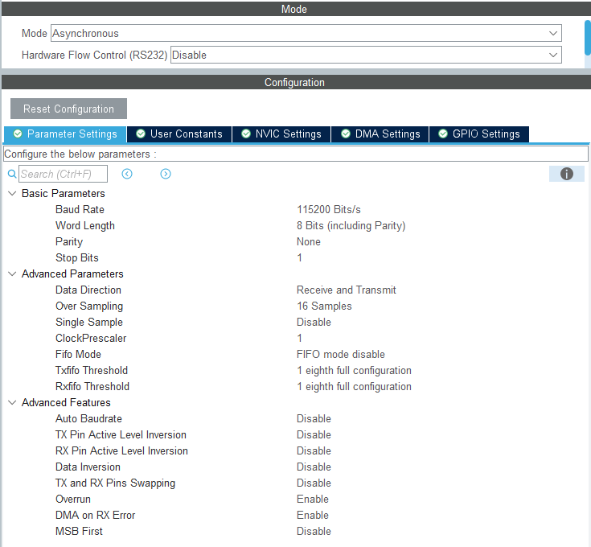
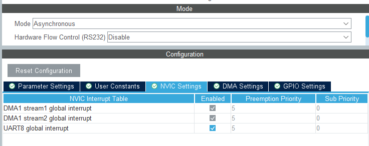
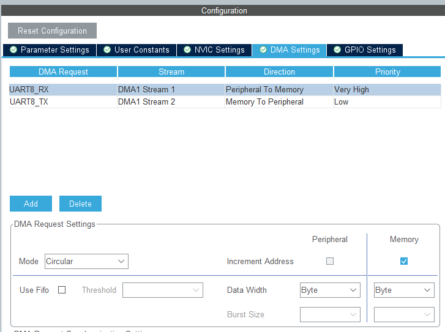
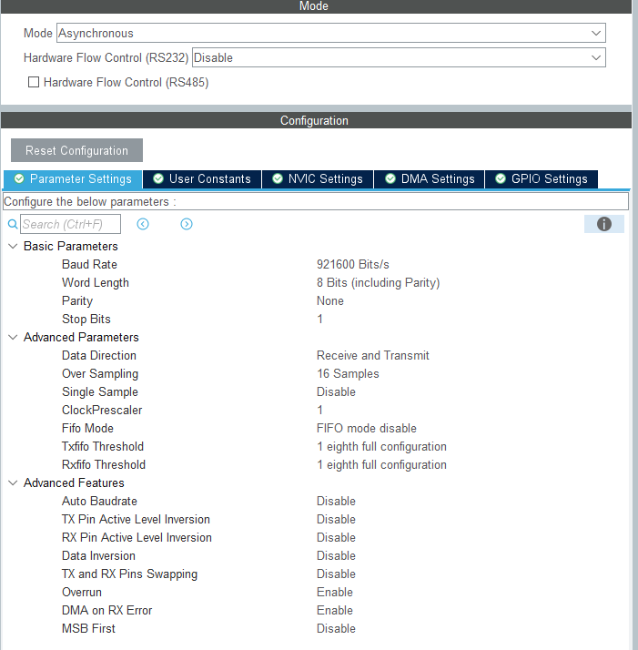
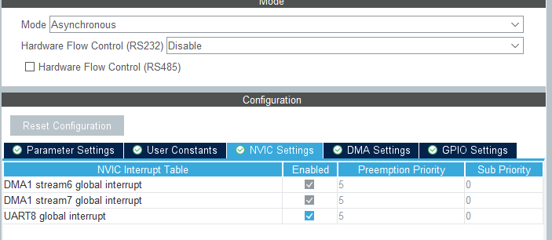
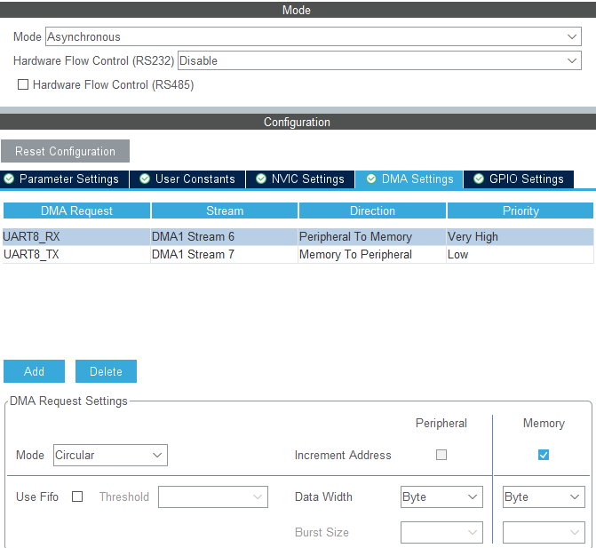

# cmd相关 使用说明

## 快速上手
### 确保配置正确
#### 以下为电管串口配置




#### 以下为图传串口配置



### 使用此单例初始化即可
   
```cpp
    // 通信任务初始化
    RoboCmdGimbal_c::GetInstance()->Init();
```
dt7和裁判系统也可分开单独使用，定义USE_DR16和USE_REFEREE即可
### 数据读取
```cpp
    Dr16_n::DT7Ctrl_t *GetDT7data()
    {
        return &DR16->dt7_data_;
    }
    Referee_n::RefereeData_t *GetREdata()
    {
        return &REFEREE->referee_data_;
    }
    Referee_n::VT13data_t *GetVT13data()
    {
        return &REFEREE->vt13_data_;
    }
```
