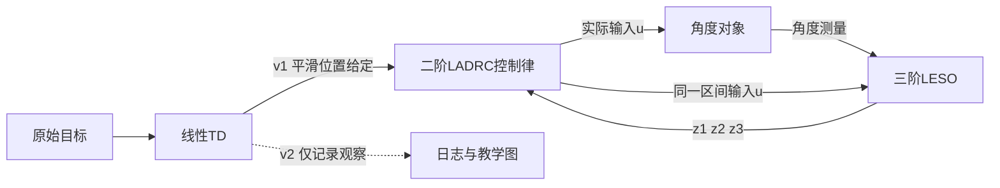

# 第14讲：TD接入二阶LADRC——平滑目标、控制峰值与到位时间

前置：[第13讲：二阶LADRC闭环](13_二阶LADRC闭环.md)。

**教学归属：线性TD与二阶LADRC组合。** 本讲保持对象、控制器、LESO和负载不变，
只把位置给定从原始阶跃换成线性TD的平滑输出。

## 1. 先看接在哪里

接入TD的一组按以下关系工作：



比较组让原始目标直接进入同一控制律。两组均保留扰动补偿。
TD用于处理目标，LESO用于估计对象，两者的位置和职责不同。

## 2. 五个状态不要混淆

| 状态 | 所属模块 | 含义 | 本例单位 |
| --- | --- | --- | --- |
| v1 | TD | 平滑后的位置给定 | rad |
| v2 | TD | 平滑目标的变化率状态 | rad/s |
| z1 | LESO | 对象角度估计 | rad |
| z2 | LESO | 对象角速度估计 | rad/s |
| z3 | LESO | 总扰动估计 | rad/s² |

v2描述目标信号怎样变化，z2估计对象正在怎样运动。即使单位相同，也不能直接互换。
本讲先只用v1作为位置给定，v2保存下来观察，不接入控制律。

## 3. 沿用第8讲的线性TD

参考你给的 `MyLibrary/TD2_L.m:33～35`：

$$
v_{1,k+1}=v_{1,k}+h v_{2,k}
$$

$$
v_{2,k+1}=v_{2,k}+h[-r_{td}^2(v_{1,k}-r_{raw,k})-2r_{td}v_{2,k}]
$$

`r_raw`是原始位置目标，`r_td`是线性TD的频率参数，含义不同。
线性TD的r_td不是速度上限或电流上限。

| 项目 | 本讲值 | 来源与适配 |
| --- | --- | --- |
| TD频率参数r_td | 5 | 原MODEL/TD2_L_MODEL.mdl的基准参数 |
| 原TD模型步长 | 0.01秒 | 单独记录原值 |
| 本讲TD实际步长 | 0.001秒 | 与控制任务的实际调用周期统一 |
| 控制h、b0、wo | 0.001秒、40、40 rad/s | 原tuning.m，沿用第13讲 |
| 控制wc | 8 rad/s | 沿用第13讲教学选择，原值150另行保存 |
| 原始目标 | 0.5秒由0变为1 rad | 沿用第13讲教学场景 |
| 总扰动 | 2.5秒由0变为-2 rad/s² | 沿用第13讲教学场景 |
| 观察时间 | 6秒，无噪声、理想无限幅输入 | 沿用第13讲教学条件 |

TD与控制器在本讲均每1 ms更新一次，传入的h也均为1 ms。
不能实际每1 ms调用，却仍把原TD模型的10 ms当成每次推进的时间。
原函数逐拍对照也显式传入本讲的实际h，不修改参考文件。

参考目录仍为你指定的 `D:/ACE/ADRC/ADRC1`。
本讲组合原TD公式与原二阶LADRC结构，新增目标处理对比，不运行或改写完整原模型。

## 4. 控制律只替换位置给定

第13讲直接给定：

$$
u=\frac{\omega_c^2(r_{raw}-z_1)-2\omega_c z_2-z_3}{b_0}
$$

本讲接入TD的一组：

$$
u=\frac{\omega_c^2(v_1-z_1)-2\omega_c z_2-z_3}{b_0}
$$

位置给定逐渐变化，位置反馈不再立即承受完整的1 rad目标跳变，因此本例电流峰值明显减小。
速度反馈、扰动补偿、LESO增益和对象参数没有改变。

这个控制律仍是位置给定与零速度基准反馈，没有增加目标速度或目标加速度前馈。
因此过渡过程中，即使估计理想，对变化中的v1也会有动态跟踪误差。
不能把第13讲“目标保持常数时”的齐次误差方程直接套到整个移动给定过程。

以后若要使用v2或目标加速度信息，需要另外说明控制律变化并验证。

## 5. 每拍使用哪个v1

实际任务可以按下面的时间标签组合：

```matlab
% 当前保存td[k]和z[k]，当前测量为measurement[k]。
control_target = td(1);
u = adrc_control2(control_target,z,b0,wc);
z_next = adrc_leso3_step(z,u,measurement,b0,beta1,beta2,beta3,h);
td_next = ltd_step(td,raw_target,r_td,h);
% 下一采样时刻再保存并使用z_next、td_next。
```

本拍控制使用本拍v1，不能把算出来的下一拍TD状态直接贴上当前时间标签。
原始目标刚跳变时，保存的v1、v2仍是旧状态；TD随后按离散动态逐步变化。

教学仿真先计算TD轨迹，再运行两组闭环，因为TD只依赖原始目标，不依赖对象反馈。
这与逐拍交错调用等价；闭环按第k行读取TD第k拍状态，没有使用未来值。
完整闭环对照使用原TD函数产生的对应轨迹，另外检查这种连接和时间标签。

## 6. 比较指标必须对齐

同时记录两种误差：

$$
e_{raw}=r_{raw}-y,\qquad e_{control}=r_{control}-y
$$

接入TD时，r_control=v1。平滑给定还没达到最终目标时，仅看v1-y可能显得误差很小，
但对象距离用户原始目标仍可能很远，所以本讲到位指标统一使用e_raw。

指标窗口固定为目标阶跃后、负载出现前的0.5～2.3秒：

- 电流峰值：该窗口内实际输入的绝对值最大值。
- 到位时间：按原始目标的2%误差带，即±0.02 rad；最后一次超出误差带后，
  下一拍进入并保持到窗口末端的时刻，减去阶跃开始时刻0.5秒。

这是有限观察窗口内的到位耗时。平滑目标与原始目标的误差不会被混成同一指标。

## 7. 本次结果

| 目标处理 | 负载前电流峰值/A | 原始目标到位耗时/s |
| --- | --- | --- |
| 直接阶跃给定 | 1.6 | 0.727 |
| 线性TD的v1给定 | 0.1265 | 1.505 |

接入TD后，本例目标过渡更缓，输入峰值更低，到达原始目标的时间也更长。
1.505秒是从0.5秒目标阶跃开始计算的耗时，对应仿真时刻约2.005秒。

5～6秒的稳态统计中，两组对原始目标的误差都接近零，维持负载的输入均约0.05 A。
TD没有替代LESO，也没有改变负载所需的维持作用。

这些结果只对应本次模型和参数。TD可以降低某些目标过渡造成的输入峰值，
但不对任意目标、扰动、初态提供电流上限保证；实际输入限幅需要单独实现。

## 8. 运行与读图

根目录 `start.m` 已默认选择 `lesson_id=14`，按F5运行整个文件。
也可直接打开 `matlab/第14讲_TD接入二阶LADRC/run_lesson.m`。

```matlab
run('D:/ACE/Infantry_dev/ADRC/matlab/第14讲_TD接入二阶LADRC/run_lesson.m')
```

需要MATLAB和上述本机ADRC1参考文件，不需要启动Simulink模型。

- 左上：原始目标、TD平滑目标，以及两组真实角度。
- 右上：控制输入峰值。
- 左下：TD的v2与接入TD后LESO的z2，分别代表目标变化率和对象角速度估计。
- 右下：统一按原始目标计算的跟踪误差。

图放大显示目标过渡阶段；完整6秒轨迹和负载响应保存在数据文件中。

输出位于 `build/lesson14/`：

- `td_trajectory.csv`：TD的原始目标、v1、v2与当前时间标签。
- `td_ladrc_sim.csv`：两组闭环共12002行数据，分别保存原始目标、控制给定和两类误差。
- `td_ladrc_metrics.csv`：电流峰值、原始目标到位耗时、稳态误差与维持输入。
- `td_ladrc_result.mat`：教学归属、来源、轨迹、参数与验证结果。
- `td_ladrc_response.fig/.png/.svg`：中文教学图。

## 9. 核对范围与下一步

脚本逐拍比较TD与原TD2_L函数，使用原TD轨迹和原LESO矩阵核对完整离散闭环，
并检查两组原始目标一致、结果有限以及末态误差和维持输入。
沿用第13讲的五状态闭环矩阵稳定性检查；TD本身满足当前前向欧拉参数范围。
这些验证针对当前理想教学模型，不代表实际硬件或任意参数保证。

本机MATLAB R2025b已从临时目录、默认搜索路径分别运行课程入口和根目录 `start.m`，均通过。
TD与原函数的最大差值为0，两组闭环共12002行数据，完整闭环对照最大差值约 `1.40e-12`。
已检查中文图形，记录在 `build/lesson14/entry_verification.json`。

本讲复用现有TD、控制律和LESO公式，只新增组合实验；没有修改C++核心。
继续：[第15讲：限幅与实际输入反馈](15_限幅与实际输入反馈.md)。

自查：TD的v2与LESO的z2单位一样，为什么本讲仍把它们分开记录？
