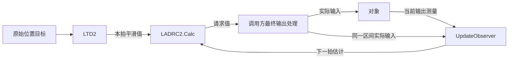

# 第19讲：TD、二阶LADRC与实际输入反馈的完整C++示例

前置：[第18讲：线性TD的C++实现](18_线性TD的C++实现.md)。

**教学归属：工程接入。** 本讲只组合已经验证的LTD2、LADRC2与内部LESO3，
不新增控制器封装，不改变算法公式，也不把限幅策略写进公共核心。

## 1. 完整代码在哪里

`examples/19_complete_integration/control_example.cpp` 是可编译运行的主机例程。
其中编号1～6展示可迁移的调用顺序；CSV读写、命令行参数和编号7的对象模型用于主机验证。

完整数据流为：



v2仍只记录观察，没有加入目标速度或加速度前馈，控制律与第13、14、17讲一致。

## 2. 一拍的顺序

在k拍保存TD状态v[k]与观测状态z[k]，当前测量为y_meas[k]：

1. 获得当前输出测量。
2. 读取TD当前平滑值v1[k]。
3. 用v1[k]和z[k]计算未限幅请求u_req[k]。
4. 调用方完成最终输出处理，得到本区间实际输入u_act[k]并提交输出。
5. 用u_act[k]、y_meas[k]将LESO预测到z[k+1]。
6. 用原始目标将TD推进到v[k+1]，下一拍再使用。

下面是成功路径的接口顺序，实际工程需要逐个检查bool返回值：

```cpp
const float smooth_target = td.GetOutput();
float requested = 0.0f;
bool calculated = controller.Calc(smooth_target, requested);
if (calculated)
{
    float applied = std::max(input_min, std::min(input_max, requested));
    // 在此将最终输出提交给执行器。
    bool observed = controller.UpdateObserver(applied, measurement, dt);
    if (observed)
    {
        bool planned = td.Update(raw_target, dt);
        // 调用方检查planned，并处理各处失败分支。
    }
}
```

`std::min/std::max`使用 `<algorithm>`。完整源文件包含实际返回值检查，遇错结束主机演示。
真实固件的失败处理策略由消费工程决定；不能把主机程序退出行为直接当作控制任务策略。
各模块的失败保持约定作用于各自状态，本例不承诺整个调用序列失败时统一回滚。

这里的u_act必须符合所建模型的实际作用量约定。
若还有后级功率限制或执行器动态，继续核对最终输入、单位和时间区间，不能只反馈前一级请求。

## 3. 为什么先读TD再推进

当前GetOutput读到v1[k]。Update成功后已经变成v1[k+1]。
本讲沿用第14讲的时间标签，避免把下一拍目标与本拍估计混合。

原始目标在0.5秒由0跳变为1时，保存的TD平滑值仍为0，所以这一拍控制请求仍为0。
TD随后按动态逐步过渡；脚本专门检查这拍没有偷用未来状态。

TD和LESO每个区间各推进一次。GetOutput和Calc都不会帮忙推进另一个模块。
闭环没有重置TD来追随每个新目标，目标反向变化时也保留连续的TD动态。

## 4. 初始化和变量来源

本例从零位置、零速度和零外部扰动开始：

```cpp
ADRC::LTD2 td;
ADRC::LADRC2 controller;
bool td_ready = td.Init(td_frequency, 0.0f, 0.0f);
bool control_ready = controller.Init(b0, omega_c, omega_o, 0.0f, 0.0f, 0.0f);
```

使用前检查初始化结果。真实非零状态接管时，TD初值、观测初值和原输出输入需要按实际情况对齐，
不能把本例零初态直接当作所有机器人姿态的默认配置。

| 量 | 本例来源 | 是否直接送入算法 |
| --- | --- | --- |
| 原始位置目标 | 输入文件的阶跃与反向变化 | 送给TD |
| 角度测量 | 当前对象角度转为float | 送给LESO |
| 控制实际输入 | 调用方对请求作最终限制 | 作用于对象并送给LESO |
| 真实角速度 | 仿真对象内部状态 | 仅日志与对照 |
| 真实外部扰动 | 输入文件中的已知教学负载 | 只施加给仿真对象，不直接传给控制器或LESO |

所以C++控制器没有使用仿真里的真实速度或真实扰动作为捷径。

## 5. 教学设置与原代码的关系

参数参考你指定的ADRC1：

- `LADRC实现参考/MATLABDemo-LADRC 实现(高志强老师)/LADRC Demo/tuning.m`：h=0.001秒、b0=40、wo=40。
- 同目录Motion_acc03.mdl：LESO矩阵与反馈、扰动补偿的结构。
- `MyLibrary/TD2_L.m` 与 `MODEL/TD2_L_MODEL.mdl`：线性TD结构与r=5。

本讲TD实际调用周期也为0.001秒，原TD模型记录的0.01秒单独保留。
控制wc使用前几讲教学值8，原wc=150另行记录，不冒充原完整模型复现。

| 新增教学场景 | 设置 |
| --- | --- |
| 原始目标 | 0.5秒变为1 rad，3.5秒反向变为-0.5 rad |
| 外部总扰动 | 2.5秒由0变为-2 rad/s² |
| 观察时间 | 8秒，末段统计7～8秒 |
| 两组输出处理 | 一组无限幅，一组外部±0.1 A限幅 |
| 对象与测量 | 匹配b0的二阶角度模型、精确ZOH对象、无测量噪声 |

两组都接入TD，只有输入限制不同。最终维持负载所需约0.05 A，在±0.1 A范围内。
场景、限幅和信号单位是教学假设，均不作为公共库的机器人默认值。
原参考文件保持只读。

## 6. 这次怎样验证完整链路

MATLAB入口先重新编译并运行三个相关核心的主机测试，再编译完整C++例程。
C++自行保存对象状态、执行TD与LADRC、处理限幅、更新LESO并推进对象，没有由MATLAB代算控制输出。

两层MATLAB核对分别是：

1. **同输入single回放**：使用C++实际测量，核对TD本拍值、请求、实际输入，以及五个状态的更新前后值。
2. **独立double闭环**：使用原TD2_L函数、原LESO矩阵与原控制增益表达式，自行推进自己的对象和估计，不回放C++测量。

两组原始目标、负载和周期一致，输入参数先量化为float，再将同一数值交给参考。
检查相邻拍before/after关系、原始目标刚跳变时的旧状态使用、实际输出边界和末段负载平衡。

## 7. 本次结果

| 场景 | 请求绝对峰值/A | 实际绝对峰值/A | 累计限幅时间/s | 末段平均输入/A |
| --- | --- | --- | --- | --- |
| TD接入、无限幅 | 0.1398 | 0.1398 | 0 | 约0.05 |
| TD接入、外部±0.1 A限幅 | 0.5487 | 0.1 | 1.796 | 约0.05 |

限幅组的请求可以比无限幅组更大，因为执行能力受限会增加暂态跟踪偏差。
实际作用量仍保持在边界内，LESO也始终使用处理后的实际输入。
这再次说明TD目标平滑与输入限幅是不同功能。

图中限幅组在反向过渡时出现明显位置超调：负载为-2 rad/s²时，正向最大输入0.1 A
只能提供净角加速度 `40*0.1-2=2 rad/s²`，无法按未限幅请求完成同样的制动过程。
示例保留这一现象，说明接线正确仍需在执行能力约束下验证目标过渡和反馈参数。
它没有保证全程输出都处在目标区间内。

两组末段平均原始目标误差分别约-2.83e-6 rad与-2.02e-6 rad。
相对独立double完整闭环，最大位置差约2.70e-6 rad，实际输入差约9.30e-6 A。
两组各8001拍，同输入回放的控制请求、两个TD状态和三个LESO状态逐拍完全一致。

这些是本次构建、参数和理想对象下的结果，不是实机定位精度指标，也不代表任意限幅系统稳定性证明。
限幅时间按实际传入的float周期与已模拟区间累计，不把最后一行预测算作额外采样区间。

## 8. 一键运行

根目录 `start.m` 选择教学模式并设置本讲number，按F5运行。
也可打开 `matlab/教学/第19讲_完整C++接入示例/run_lesson.m`。
需要MATLAB、g++与本机ADRC1参考文件，不需要MEX或启动Simulink。
编译器探测与PATH临时恢复方式沿用第16讲。

图中展示限幅组的原始目标、平滑给定、实际角度、控制输入、变化率和扰动估计。
输出位于 `build/lesson19/`：

- 三个核心的主机测试程序与 `control_example.exe`。
- `control_input.csv`：原始目标、外部负载与实际周期。
- `unlimited_cpp.csv`、`limited_cpp.csv`：C++自主闭环的五个状态、对象、请求和实际输入。
- `integration_comparison.csv`、`integration_metrics.csv`：独立对照与分层指标。
- `integration_result.mat`：参数、来源、编译器、测试输出与数据。
- `complete_integration.fig/.png/.svg`：中文教学图。

CSV的before是当前状态，after是对应下一拍预测。最后一行after不是新的当前拍采样。

## 9. 真正放进消费工程时拿哪些文件

头文件搜索路径添加 `main/`，编译统一的核心实现：

```text
main/ALG_ADRC.cpp
```

控制任务包含 `ALG_ADRC.hpp`，保留实例跨周期状态。
将例程编号1～6中的目标、测量、实际周期与最终输出换成消费工程提供的量，并处理返回值。
不要将CSV解析、仿真对象推进或主机日志代码加入固件控制环。

本步没有修改核心算法；既有核心的M4/M7对象编译记录见第16～18讲。
新增完整例程验证的是主机接入流程，尚未实际固件链接、板上时序或电机验证。

## 10. 本机运行记录

2026-10-28，使用MATLAB R2025b与GCC 16.1.0验证。课程入口和根目录入口均从临时目录、默认MATLAB搜索路径运行通过，临时编译器PATH已恢复。
三个相关核心的主机测试通过；两组共16002次更新中，同输入回放的控制请求、两个TD状态和三个LESO状态与MATLAB single逐拍完全一致。
独立double闭环的位置最大差值约2.70e-6 rad，实际输入最大差值约9.30e-6 A；中文图形已检查。
入口验证记录为 `build/lesson19/entry_verification.json`。这些验证限于本讲主机模型。

基础接入链路至此已有可运行示例。下一步进入[第20讲：一阶对象的降阶LESO](20_一阶对象的降阶LESO.md)，先学习状态变换与测量依赖。
